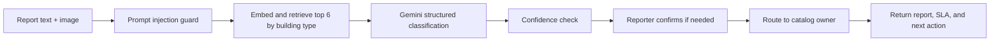

# S.O.S. — Spark On-Site Solutions

> AI-powered campus hazard reporting system — Applied Generative AI course project

## Architecture

```
┌─────────────────────────────────────────────────────────┐
│                     Frontend (React)                     │
│  Login │ Feed │ New Report │ Detail │ Authority │ Admin  │
└───────────────────────┬────────────────────────────────┘
                        │ REST API (JWT)
┌───────────────────────▼────────────────────────────────┐
│                  Backend (FastAPI)                       │
│                                                          │
│  /auth   /reports   /notifications   /analytics         │
│  /locations                                              │
│                                                          │
│  ┌─────────────────────────────────────────────────┐   │
│  │               Services Layer                     │   │
│  │  ai_classifier │ duplicate_detector              │   │
│  │  priority_engine │ router │ notifier             │   │
│  └──────────────────────┬──────────────────────────┘   │
│                          │                               │
│  ┌───────────────────────▼──────────────────────────┐  │
│  │         SQLAlchemy ORM + SQLite                   │  │
│  │  User │ Report │ Hype │ StatusLog                 │  │
│  │  Verification │ Notification │ Location           │  │
│  └──────────────────────────────────────────────────┘  │
└────────────────────────────────────────────────────────┘
                          │
              ┌───────────▼──────────┐
              │    Gemini API        │
              │  Vision + Embeddings │
              └──────────────────────┘
```

### Catalog classification pipeline



The catalog contains 185 distinct sub-services across the 24 supplied groups. Repeated services remain separate where their building context or owner differs. Gemini model names are configured through `GEMINI_MODEL` and `EMBEDDING_MODEL`; the classifier falls back to catalog keyword matching when Gemini is unavailable. SQLite startup applies an additive migration for catalog fields and location building types without dropping existing rows.

## Setup (Local Development)

### 1. Clone and configure

```bash
git clone <repo>
cd SOS
cp .env.example .env
# Edit .env — add your GEMINI_API_KEY and a random JWT_SECRET
cp .env.example backend/.env   # backend reads .env from its working directory
```

### 2. Backend

```bash
cd backend
python -m venv venv
source venv/bin/activate          # Windows: venv\Scripts\activate
pip install -r requirements.txt
python seed.py                    # seeds demo data
uvicorn app.main:app --reload --port 8000
```

Backend runs at [http://localhost:8000](http://localhost:8000)  
API docs at [http://localhost:8000/docs](http://localhost:8000/docs)

### 3. Frontend

```bash
cd frontend
npm install
npm run dev
```

Frontend runs at [http://localhost:5173](http://localhost:5173)

### 4. Run tests

```bash
cd backend
pytest tests/ -v
python scripts/test_classifier.py   # AI classifier smoke test
```

---

## Docker (one command)

```bash
cp .env.example .env   # fill in GEMINI_API_KEY and JWT_SECRET
docker-compose up --build
```

Frontend → [http://localhost:5173](http://localhost:5173)  
Backend → [http://localhost:8000](http://localhost:8000)

---

## Demo Credentials

| Role | Email | Password |
|---|---|---|
| Admin | admin@university.edu | admin123 |
| Electrical | raj.elec@university.edu | auth123 |
| Civil | priya.civil@university.edu | auth123 |
| Security | suresh.sec@university.edu | auth123 |
| Hostel Warden | warden@university.edu | auth123 |
| IT | it@university.edu | auth123 |
| Fire & Safety | fire.safety@university.edu | auth123 |
| Housekeeping | housekeeping@university.edu | auth123 |
| HVAC | hvac@university.edu | auth123 |
| Student | arjun@student.edu | student123 |
| Student | sneha@student.edu | student123 |

---

## API Endpoint Summary

| Method | Path | Auth | Description |
|---|---|---|---|
| POST | /auth/register | — | Create account |
| POST | /auth/login | — | Get JWT |
| GET | /auth/me | JWT | Current user |
| POST | /reports | JWT | Submit report (multipart) |
| GET | /reports | JWT | List with filters & pagination |
| GET | /reports/mine | JWT | My own reports |
| GET | /reports/{id} | JWT | Full report detail |
| PATCH | /reports/{id}/status | authority/admin | Update status + note |
| PATCH | /reports/{id}/assign | admin | Reassign to authority |
| POST | /reports/{id}/hype | JWT | Upvote |
| DELETE | /reports/{id}/hype | JWT | Remove upvote |
| POST | /reports/{id}/resolve | authority | Submit after-photo |
| POST | /reports/{id}/confirm | JWT (reporter) | Confirm or dispute fix |
| POST | /reports/admin/auto-resolve-stale | admin | Auto-resolve 72h+ pending |
| GET | /notifications | JWT | My notifications |
| PATCH | /notifications/read | JWT | Mark all read |
| GET | /analytics/summary | admin | Full analytics |
| GET | /locations | JWT | Campus locations |
| GET | /health | — | Health check |

Reports now also include `intent`, `service_group`, `service_subcategory`, `catalog_id`, three confidence values, `prompt_version`, and `sla_hours`. When group confidence is at least 0.6 but subcategory confidence is below 0.6, the create response includes up to three choices; the reporter can confirm one with `PATCH /reports/{id}/classification`.

## Catalog Evaluation

The evaluation set is synthetic and includes overlapping service cases, service requests, and unrelated reports. Run the local baselines and Gemini configurations with:

```bash
cd backend
python scripts/eval_catalog.py
```

The script compares keyword matching, TF-IDF + LogisticRegression, full-catalog Gemini zero-shot, and top-6 retrieval + few-shot Gemini, then writes `docs/RESULTS.md`. Gemini metrics require an API key with request quota. See the results document for configurations that could not run because the configured project had no API quota.

---

## 5-Minute Demo Script

1. **Login as student** (arjun@student.edu) → shows live priority feed
2. **New Report** → upload a hazard photo → AI classifies it live → shows severity, type, reasoning
3. **Duplicate detection** → submit a very similar report → it gets auto-merged and merged message shown
4. **Login as authority** (raj.elec@university.edu) → Kanban view → drag to In Progress
5. **Resolve** → upload after-photo → AI match check runs
6. **Back to student** → confirm resolution → status becomes Resolved
7. **Login as admin** → show analytics: reports per day chart, category donut, hotspot grid
8. **Hype surge** → click "Simulate Hype Surge" → priority scores update live

---

## Known Limitations

- SQLite is demo-only; use PostgreSQL for production
- Gemini free tier is 15 req/min; use keyword fallback under load
- Email/SMS notifications are mocked (logs to console)
- No image compression; large images may be slow on mobile
- Seeded reports don't have Gemini embeddings; duplicate detection uses keyword fallback for them
- JWT tokens are not revocable (no logout invalidation)

---

## Project Structure

```
SOS/
├── backend/
│   ├── app/
│   │   ├── main.py           # FastAPI app, CORS, routes
│   │   ├── models.py         # SQLAlchemy models
│   │   ├── schemas.py        # Pydantic I/O schemas
│   │   ├── database.py       # DB session
│   │   ├── core/config.py    # Settings from .env
│   │   ├── routers/          # auth, reports, notifications, analytics, locations
│   │   └── services/         # ai_classifier, duplicate_detector, priority_engine, router, notifier
│   ├── seed.py               # Demo data seeder
│   ├── scripts/
│   │   └── test_classifier.py
│   ├── tests/test_main.py
│   └── requirements.txt
├── frontend/
│   ├── src/
│   │   ├── App.jsx           # Routes
│   │   ├── api/client.js     # Axios + JWT interceptor
│   │   ├── context/AuthContext.jsx
│   │   ├── components/       # Navbar, ReportCard, UI primitives, ProtectedRoute
│   │   └── pages/            # Login, Home, NewReport, ReportDetail, MyReports, Authority, Admin
│   └── package.json
├── docs/EVALUATION.md
├── docker-compose.yml
└── .env.example
```

---

## Contributors

| Avatar | Name | GitHub | Role |
|--------|------|--------|------|
|  | **E. Harikrishna** | [@harikrishhh07](https://github.com/harikrishhh07) | Creator & Full-Stack Developer |

---

> Built as part of an Applied Generative AI course project.
